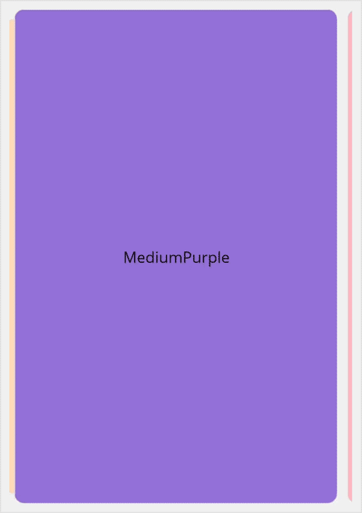

# Getting started with .NET MAUI Card
This section details the process of integrating the [.NET MAUI Cards](https://www.syncfusion.com/maui-controls/maui-cards) control and focuses solely on the fundamental features required for initiating your exploration of Syncfusion&reg; Card.

## Register Syncfusion handler

Make sure to add the namespace.


using Syncfusion.Maui.Core.Hosting;
 

Register the Syncfusion core handler in your `CreateMauiApp` method of `MauiProgram.cs` file to use Syncfusion controls.


builder.ConfigureSyncfusionCore();
 

## Import the Card namespace

Add the following namespace in your XAML or C#.



xmlns:cards="clr-namespace:Syncfusion.Maui.Cards;assembly=Syncfusion.Maui.Cards"


using Syncfusion.Maui.Cards;



## Add the Card component

Create an instance for the Card control, and add it as content.



<cards:SfCardView>
    <Label Text="CardView" 
           Background="PeachPuff" 
           HorizontalTextAlignment="Center" 
           VerticalTextAlignment="Center"/>
</cards:SfCardView>


    SfCardView cardView = new SfCardView();
    cardView.Content = new Label()
    {
        Text = "CardView",
        HorizontalTextAlignment = TextAlignment.Center,
        VerticalTextAlignment = TextAlignment.Center,
        BackgroundColor = Colors.PeachPuff
    };
    this.Content = cardView;



The following screenshot illustrates the result of the above code.

### Define the card layout

Initialize a card layout with a card view using the provided code sample below.




<cards:SfCardLayout HeightRequest="500" BackgroundColor="#F0F0F0">

    <cards:SfCardView CornerRadius="10">
        <Label  Text="Peach" BackgroundColor="PeachPuff"/>
    </cards:SfCardView>

    <cards:SfCardView CornerRadius="10">
        <Label  Text="MediumPurple" BackgroundColor="MediumPurple"/>
    </cards:SfCardView>

    <cards:SfCardView CornerRadius="10" >
        <Label  Text="LightPink" BackgroundColor="LightPink"/>
    </cards:SfCardView>

</cards:SfCardLayout>



    SfCardLayout cardLayout = new SfCardLayout();

    //Add children for card layout 
    cardLayout.Children.Add(new SfCardView() { Content = new Label() { Text = "Peach", BackgroundColor = Colors.PeachPuff }, CornerRadius = 15 });

    cardLayout.Children.Add(new SfCardView() { Content = new Label() { Text = "MediumPurple", BackgroundColor = Colors.MediumPurple },CornerRadius = 15 });

    cardLayout.Children.Add(new SfCardView() { Content = new Label() { Text = "LightPink", BackgroundColor = Colors.LightPink },CornerRadius = 15 });

    this.Content = cardLayout;

	

The following screenshot illustrates the result of the above code.

N> You can refer to our [.NET MAUI Cards](https://www.syncfusion.com/maui-controls/maui-cards) feature tour page for its groundbreaking feature representations. You can also explore our [.NET MAUI Cards Example](https://github.com/syncfusion/maui-demos/tree/master/MAUI/Cards) that shows you how to render and configure the Cards in .NET MAUI.